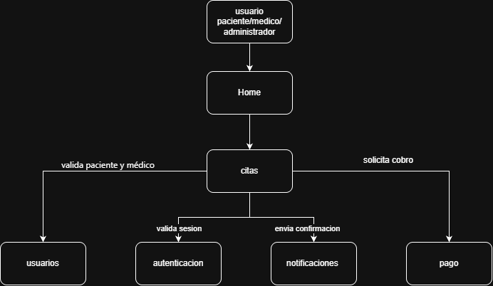

# Gestión de Citas Médicas Distribuida

## Problema que resuelve
Actualmente el consultorio agenda las citas de forma manual (llamadas telefónicas o agenda física), lo que genera cruces de horario, citas duplicadas, olvidos y errores al registrar información. Este sistema centraliza el agendamiento, la confirmación y el recordatorio de citas médicas en una sola plataforma.

## Objetivo
Automatizar y centralizar el proceso de agendamiento y gestión de citas médicas mediante un sistema distribuido, garantizando escalabilidad y eliminando errores humanos en la asignación de horarios.

## Integrantes y Roles
* Daniel Eduardo Lasso: Arquitectura y diagrama.
* Luis Enrique Ruiz: Dockerfile y vista Home.
* Javier Alejandro Guaca: Docker Compose y orquestación de servicios, investigacion de servicios e imagenes .
* Francisco Javier Galindez: Documentación (README) y definición de APIs.

## Arquitectura del Sistema
Para este proyecto se seleccionó una arquitectura basada en microservicios, porque cada servicio (usuarios, autenticación, citas, notificaciones y pagos) tiene una responsabilidad distinta y puede desarrollarse, desplegarse y escalarse por separado. El servicio de Citas actúa como orquestador principal, ya que es el que más solicita información a los demás servicios para validar y completar una cita.




## Servicios implementados

| Servicio | Responsabilidad | Información administrada | Comunicación con otros servicios |
| --- | --- | --- | --- |
| Usuarios | Gestionar pacientes, médicos y administradores | Nombre, documento, email, teléfono, rol, especialidad, horario | Responde a Citas (GET /usuarios/{id}) |
| Pagos | Registrar las transacciones y su estado | Monto, estado del pago, fecha de creación | Responde a Citas (GET /pagos/{id}) |
| Citas | Gestionar la agenda y consolidar la información de cada cita | Usuario, pago asociado, fecha, hora, estado de la cita | Consulta a Usuarios y a Pagos |

## Endpoints

Todas las peticiones y respuestas usan JSON. En POST y PUT se debe enviar el encabezado Content-Type: application/json.

### Servicio Usuarios — http://localhost:5000

| Método | Endpoint | Descripción | Entrada | Respuesta |
| --- | --- | --- | --- | --- |
| GET | /usuarios | Consultar todos los usuarios | Ninguna | 200 · Lista de usuarios |
| GET | /usuarios/{id} | Consultar un usuario | ID en la URL | 200 · Usuario · 404 si no existe |
| POST | /usuarios | Crear usuario | JSON: nombre, documento, rol (obligatorios); email, telefono, especialidad, horario (opcionales) | 201 · {"mensaje": "usuario creado", "id": 6} · 400 si falta un campo obligatorio · 409 si el documento ya existe |
| PUT | /usuarios/{id} | Actualizar usuario (se pueden enviar solo los campos que cambian) | ID + JSON con los campos a cambiar | 200 · `{"mensaje": "usuario actualizado"}` · 404 |
| DELETE | /usuarios/{id} | Eliminar usuario | ID en la URL | 200 · Mensaje + usuario eliminado · 404 |

Ejemplo de creación:

```json
POST /usuarios
{
  "nombre": "María Gómez",
  "documento": "1003",
  "email": "maria@correo.com",
  "telefono": "3015556677",
  "rol": "paciente"
}
```

### Servicio Pagos — http://localhost:5001

| Método | Endpoint | Descripción | Entrada | Respuesta |
| --- | --- | --- | --- | --- |
| GET | /pagos | Consultar todos los pagos | Ninguna | 200 · Lista de pagos |
| GET | /pagos/{id} | Consultar un pago | ID en la URL | 200 · Pago · 404 |
| POST | /pagos | Registrar un pago | JSON: monto, estado (obligatorios); creado (opcional, formato AAAA-MM-DD HH:MM:SS) | 201 · {"mensaje": "Pago creado con éxito", "id": 3} · 400 si falta monto o estado |
| PUT | /pagos/{id} | Actualizar monto, estado o fecha | ID + JSON con los campos a cambiar | 200 · {"mensaje": "Pago actualizado con éxito"} · 404 |
| DELETE | /pagos/{id} | Eliminar un pago | ID en la URL | 200 · {"mensaje": "Pago eliminado con éxito"} · 404 |

Si no se envía creado, el servicio guarda la fecha y hora actual. Valores de estado usados en el sistema: aprobado, pendiente, rechazado.

Ejemplo de creación:

```json
POST /pagos
{
  "monto": 60000,
  "estado": "aprobado"
}
```

### Servicio Citas — http://localhost:5002

| Método | Endpoint | Descripción | Entrada | Respuesta |
| --- | --- | --- | --- | --- |
| GET | /citas | Consultar todas las citas | Ninguna | 200 · Lista de citas |
| GET | /citas/{id} | Consultar una cita | ID en la URL | 200 · Cita · 404 |
| POST | /citas | Crear cita | JSON: usuario_id, pago_id, fecha (AAAA-MM-DD), hora (HH:MM:SS), estado (todos obligatorios) | 201 · {"mensaje": "Cita creada con éxito", "id": 3} · 400 indicando los campos faltantes |
| PUT | /citas/{id} | Actualizar cita (por ejemplo, confirmarla o cancelarla) | ID + JSON con los campos a cambiar | 200 · {"mensaje": "Cita actualizada con éxito"} · 404 |
| DELETE | /citas/{id} | Eliminar cita | ID en la URL | 200 · {"mensaje": "Cita eliminada con éxito", "id": 3} · 404 |
| GET | /citas/{id}/detalles | **Integración:** cita + datos del usuario + estado del pago | ID en la URL | 200 · JSON consolidado · 404 |

Valores de estado usados en el sistema: pendiente_pago, confirmada, cancelada, completada.

Ejemplo de creación:

```json
POST /citas
{
  "usuario_id": 2,
  "pago_id": 3,
  "fecha": "2026-12-01",
  "hora": "10:00:00",
  "estado": "pendiente_pago"
}
```

---


## Comunicación entre servicios

La comunicación es síncrona por HTTP/REST con JSON. El Servicio de Citas usa la librería requests y conoce la dirección de los otros servicios por variables de entorno como USUARIOS_URL, PAGOS_URL. Dentro de Docker, cada servicio se encuentra por su nombre.

### Citas → Usuarios

| Elemento | Descripción |
| --- | --- |
| Servicio que solicita | Citas |
| Servicio que responde | Usuarios |
| Endpoint utilizado | GET /usuarios/{usuario_id} |
| Información enviada | usuario_id guardado en la cita |
| Información recibida | Datos del usuario dueño de la cita (se usan id y nombre) |

### Citas → Pagos

| Elemento | Descripción |
| --- | --- |
| Servicio que solicita | Citas |
| Servicio que responde | Pagos |
| Endpoint utilizado | GET /pagos/{pago_id} |
| Información enviada | pago_id guardado en la cita |
| Información recibida | Pago asociado (se usan id y estado) |

### Respuesta consolidada — `GET /citas/1/detalles`

```json
{
  "cita":    { "id": 1, "fecha": "2026-10-20", "hora": "09:30:00", "estado": "confirmada" },
  "pago":    { "id_pago": 1, "estado_pago": "aprobado" },
  "usuario": { "id_usuario": 1, "nombre_usuario": "Ana Torres" }
}
```
### Flujo completo de una cita

1. Se registra el usuario (o se usa uno existente): POST /usuarios.
2. Se registra el pago: POST /pagos con monto y estado (por ejemplo pendiente) → devuelve el id del pago.
3. Se crea la cita con ese pago: POST /citas con usuario_id, pago_id , fecha, hora y estado.
4. Cuando el pago se aprueba: PUT /pagos/{id} con {"estado": "aprobado"} y PUT /citas/{id} con {"estado": "confirmada"}.
5. Se consulta la información completa: GET /citas/{id}/detalles.

Cada cita **siempre** tiene un pago asociado (pago_id es obligatorio en la tabla), por eso el pago se registra antes que la cita.

---

## Bases de datos

Cada servicio tiene su propia instancia de MySQL 8.4 en un contenedor independiente. Las tablas motor InnoDB, codificación utf8mb4 se crean automáticamente con los scripts de bases_datos/ la primera vez que se levanta el sistema.

| Servicio | Contenedor | Base de datos | Tabla principal | Script |
| --- | --- | --- | --- | --- |
| Usuarios | citas_db_usuarios | usuarios_db | usuarios | bases_datos/usuarios/init.sql |
| Pagos | citas_db_pagos | pagos_db | pagos | bases_datos/pagos/init.sql |
| Citas | citas_db_citas | citas_db | citas | bases_datos/citas/init.sql |

### Tabla usuarios

| Campo | Tipo | Restricción |
| --- | --- | --- |
| id | INT | Llave primaria, autoincremental |
| nombre | VARCHAR(100) | Obligatorio |
| documento | VARCHAR(30) | Obligatorio, único |
| email | VARCHAR(100) | Opcional |
| telefono | VARCHAR(20) | Opcional |
| rol | VARCHAR(30) | Obligatorio (paciente, medico, administrador) |
| especialidad | VARCHAR(100) | Opcional (médicos) |
| horario | VARCHAR(100) | Opcional (médicos) |

### Tabla pagos

| Campo | Tipo | Restricción |
| --- | --- | --- |
| id | INT | Llave primaria, autoincremental |
| monto | DECIMAL(10,2) | Obligatorio |
| estado | VARCHAR(30) | Obligatorio (aprobado, pendiente, rechazado) |
| creado | DATETIME | Obligatorio; si no se envía, el servicio usa la fecha actual |

### Tabla citas

| Campo | Tipo | Restricción |
| --- | --- | --- |
| id | INT | Llave primaria, autoincremental |
| usuario_id | INT | Obligatorio · índice · referencia lógica al Servicio de Usuarios |
| pago_id | INT | Obligatorio · índice · referencia lógica al Servicio de Pagos |
| fecha | DATE | Obligatorio |
| hora | TIME | Obligatorio |
| estado | VARCHAR(50) | Obligatorio (pendiente_pago, confirmada, cancelada, completada) |

### Persistencia

Los datos se guardan en el volumen Docker **gestordecitas, que sobrevive a reinicios y a docker compose down. Cada MySQL guarda sus archivos en su propia subcarpeta del volumen, por lo que las bases de datos siguen completamente separadas además, cada servicio comparte una red privada únicamente con su base de datos y un servicio no puede conectarse a la base de datos de otro.


## Variables de entorno

Ninguna configuración está escrita en el código. Los valores están en .env y Docker Compose los entrega a cada contenedor.

| Variable | Uso | Valor por defecto |
| --- | --- | --- |
| USUARIOS_URL | URL con la que Citas llama a Usuarios | http://usuarios:5000 |
| PAGOS_URL | URL con la que Citas llama a Pagos | http://pagos:5001 |
| DB_USUARIOS_HOST | Host de la BD de Usuarios | db_usuarios |
| DB_USUARIOS_PORT | Puerto de la BD de Usuarios | 3306 |
| DB_USUARIOS_USER | Usuario de la BD de Usuarios | root |
| DB_USUARIOS_PASSWORD | Contraseña de la BD de Usuarios (y root de su MySQL) | root |
| DB_USUARIOS_NAME | Nombre de la BD de Usuarios | usuarios_db |
| DB_PAGOS_HOST / _PORT / _USER / _PASSWORD / _NAME | Conexión a la BD de Pagos | db_pagos · 3306 · root · root · pagos_db |
| DB_CITAS_HOST / _PORT / _USER / _PASSWORD / _NAME | Conexión a la BD de Citas | db_citas · 3306 · root · root · citas_db |
| PORT | Puerto en que escucha cada servicio Flask (lo fija el compose) | 5000 · 5001 · 5002 |

---

## Docker

### Imágenes base (Docker Hub)

| Imagen | Usada por | Por qué se eligió |
| --- | --- | --- |
| python:3.12-slim | usuarios, pagos, citas | Python 3.12 sobre Debian reducido: suficiente para Flask y mucho más liviana que python:3.12 |
| nginx:alpine | home | Servidor web muy liviano para publicar la vista HTML/CSS |
| mysql:8.4 | db_usuarios, db_pagos, db_citas | Versión LTS de MySQL 8; una instancia independiente por servicio |

### Imágenes propias

| Imagen | Dockerfile | Qué hace |
| --- | --- | --- |
| gestion_de_citas/home:1.0 | home/Dockerfile | Copia index.html y styles.css a nginx; expone el puerto 80 |
| gestion_de_citas/usuarios:1.0 | usuarios/dockerfile | Instala requirements.txt y ejecuta app.py; puerto 5000 |
| gestion_de_citas/pagos:1.0 | pagos/dockerfile | Igual; puerto 5001 |
| estion_de_citas/citas:1.0 | citas/dockerfile | Igual; puerto 5002 |

Los dockerfile de los servicios copian primero requirements.txt y después el código. Así, si solo cambia el código, Docker reutiliza la capa con las dependencias ya instaladas y la construcción es más rápida.

Dependencias de Python (requirements.txt): flask, requests y mysql-connector-python.

### Docker Compose

| Contenedor | Imagen | Puerto host:contenedor | Redes | Depende de |
| --- | --- | --- | --- | --- |
| citas_home | gestion_de_citas/home:1.0 | 8080:80 | servicios | — |
| citas_usuarios | gestion_de_citas/usuarios:1.0 | 5000:5000 | servicios, red_usuarios | db_usuarios (healthy) |
| citas_pagos | gestion_de_citas/pagos:1.0 | 5001:5001 | servicios, red_pagos | db_pagos (healthy) |
| citas_citas | gestion_de_citas/citas:1.0 | 5002:5002 | servicios, red_citas | db_citas (healthy), usuarios, pagos |
| citas_db_usuarios | mysql:8.4 | 3309:3306 | red_usuarios | — |
| citas_db_pagos | mysql:8.4 | 3310:3306 | red_pagos | — |
| citas_db_citas | mysql:8.4 | 3311:3306 | red_citas | — |

---

## Cómo ejecutar el sistema

**Requisitos:** Docker Desktop abierto y los puertos 8080, 5000, 5001, 5002, 3309, 3310 y 3311 libres.

```bash
git clone https://github.com/daniellass0/gestion_de_citas.git
cd gestion_de_citas
docker compose up --build
docker compose down -v
```

La primera vez tarda unos minutos mientras se descargan las imágenes y se inicializan las tres bases de datos.

| Componente | URL |
| --- | --- |
| Home | http://localhost:8080 |
| Usuarios | http://localhost:5000/usuarios |
| Pagos | http://localhost:5001/pagos |
| Citas | http://localhost:5002/citas |
| Integración | http://localhost:5002/citas/1/detalles |

