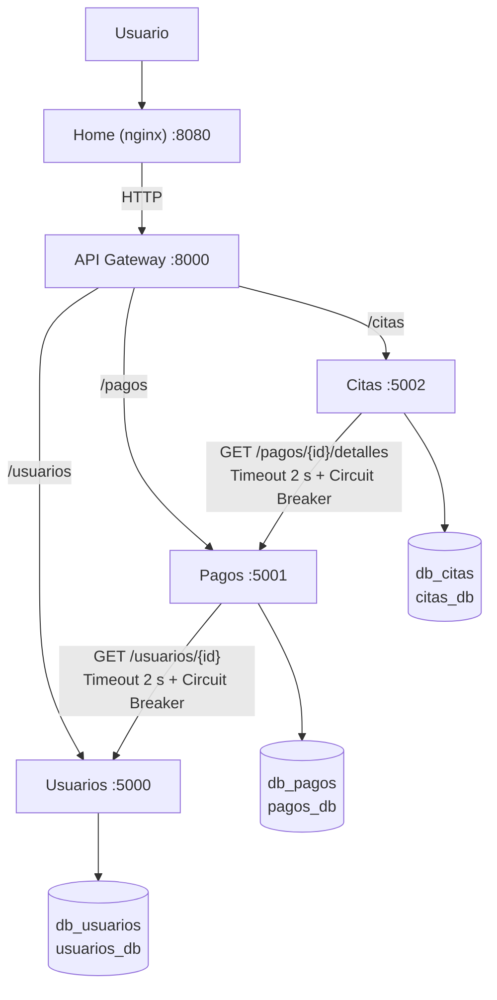

# Gestión de Citas Médicas Distribuida

## Problema que resuelve

Actualmente el consultorio agenda las citas de forma manual (llamadas telefónicas o agenda física), lo que genera cruces de horario, citas duplicadas, olvidos y errores al registrar información. Este sistema centraliza el agendamiento, la confirmación y el pago de citas médicas en una sola plataforma.

## Objetivo

Automatizar y centralizar el proceso de agendamiento y gestión de citas médicas mediante un sistema distribuido, garantizando escalabilidad y eliminando errores humanos en la asignación de horarios.

## Funcionalidades principales

* Registro y administración de usuarios (pacientes, médicos y administradores).

* Registro y seguimiento del estado de los pagos.

* Agendamiento, confirmación y cancelación de citas.

* Consulta consolidada de una cita con los datos del paciente y del pago.

* Acceso centralizado mediante un API Gateway y una vista Home conectada a él.

## Integrantes y Roles

* Luis Fernando Ruiz: Dockerfile y vista Home.

* Javier Alejandro Guaca: Docker Compose y orquestación de servicios, investigación de servicios e imágenes.

* Francisco Javier Galindez: Documentación (README) y definición de APIs.

**Nota:** Daniel Eduardo Lasso participó en el primer y segundo avance (arquitectura y diagrama) y se retiró del equipo antes del tercer avance, por lo que no participó en esta entrega. Sus aportes anteriores se conservan en el historial del repositorio.

---

## Arquitectura completa

Se seleccionó una arquitectura basada en microservicios: cada servicio (usuarios, pagos y citas) tiene una responsabilidad distinta, su propia base de datos y puede desarrollarse, desplegarse y escalarse por separado. El cliente entra por la vista Home, que consulta el API Gateway; el Gateway reenvía cada petición al microservicio correspondiente.



Todos los contenedores se definen en `docker-compose.yml`. Los microservicios y el Gateway comparten la red `servicios`; cada microservicio comparte además una red privada solo con su base de datos (`red_usuarios`, `red_pagos`, `red_citas`).

El diagrama del primer avance se conserva en `docs/img/DiagramaSD.png` (no incluye el Gateway, que se agregó en este avance).

### Inventario de servicios

| Microservicio | Responsabilidad | Base de datos | Comunicación con otros servicios | Estado |

| --- | --- | --- | --- | --- |

| Home | Interfaz principal; muestra las citas y sus detalles | — | Consulta al Gateway (GET /citas, GET /citas/{id}/detalles) | Terminado |

| Gateway | Punto de entrada único; reenvía métodos, cuerpo y códigos HTTP | — | Reenvía a Usuarios, Pagos y Citas | Terminado |

| Usuarios | Gestionar pacientes, médicos y administradores | usuarios_db (MySQL) | Responde a Pagos (GET /usuarios/{id}) | Terminado |

| Pagos | Registrar las transacciones y su estado | pagos_db (MySQL) | Consulta a Usuarios; responde a Citas (GET /pagos/{id}/detalles) | Terminado |

| Citas | Gestionar la agenda y consolidar la información de cada cita | citas_db (MySQL) | Consulta a Pagos (que a su vez consulta a Usuarios) | Terminado |

---

## Endpoints

Todas las peticiones y respuestas usan JSON. En POST y PUT se debe enviar el encabezado `Content-Type: application/json`. Los endpoints se pueden llamar directamente en el puerto de cada servicio o a través del Gateway en `http\://localhost:8000` con la misma ruta.

### Servicio Usuarios — http\://localhost:5000

| Método | Endpoint | Descripción | Entrada | Respuesta |

| --- | --- | --- | --- | --- |

| GET | /usuarios | Consultar todos los usuarios | Ninguna | 200 · Lista de usuarios |

| GET | /usuarios/{id} | Consultar un usuario | ID en la URL | 200 · Usuario · 404 si no existe |

| POST | /usuarios | Crear usuario | JSON: nombre, documento, rol (obligatorios); email, telefono, especialidad, horario (opcionales) | 201 · `{"mensaje": "usuario creado", "id": 3}` · 400 si falta un campo obligatorio · 409 si el documento ya existe |

| PUT | /usuarios/{id} | Actualizar usuario (solo los campos que cambian) | ID + JSON | 200 · `{"mensaje": "usuario actualizado"}` · 404 |

| DELETE | /usuarios/{id} | Eliminar usuario | ID en la URL | 200 · Mensaje + usuario eliminado · 404 |

```json

POST /usuarios

{

  "nombre": "María Gómez",

  "documento": "1003",

  "email": "maria@correo.com",

  "telefono": "3015556677",

  "rol": "paciente"

}

```

### Servicio Pagos — http\://localhost:5001

| Método | Endpoint | Descripción | Entrada | Respuesta |

| --- | --- | --- | --- | --- |

| GET | /pagos | Consultar todos los pagos | Ninguna | 200 · Lista de pagos |

| GET | /pagos/{id} | Consultar un pago | ID en la URL | 200 · Pago · 404 |

| POST | /pagos | Registrar un pago | JSON: usuario_id, monto, estado (obligatorios); creado (opcional, AAAA-MM-DD HH:MM:SS) | 201 · `{"mensaje": "Pago creado con éxito", "id": 2}` · 400 si falta un campo |

| PUT | /pagos/{id} | Actualizar (solo los campos que cambian) | ID + JSON | 200 · `{"mensaje": "Pago actualizado con éxito"}` · 404 |

| DELETE | /pagos/{id} | Eliminar un pago | ID en la URL | 200 · `{"mensaje": "Pago eliminado con éxito"}` · 404 |

| GET | /pagos/{id}/detalles | **Integración:** pago + datos del usuario (consulta a Usuarios) | ID en la URL | 200 · JSON consolidado · 404 · 503 · 504 |

| GET | /circuito/usuarios | Estado del Circuit Breaker Pagos → Usuarios | Ninguna | 200 · estado, fallos, umbral, recuperación |

Si no se envía `creado`, el servicio guarda la fecha y hora actual. Valores de `estado`: aprobado, pendiente, rechazado.

```json

POST /pagos

{

  "usuario_id": 1,

  "monto": 60000,

  "estado": "pendiente"

}

```

### Servicio Citas — http\://localhost:5002

| Método | Endpoint | Descripción | Entrada | Respuesta |

| --- | --- | --- | --- | --- |

| GET | /citas | Consultar todas las citas | Ninguna | 200 · Lista de citas |

| GET | /citas/{id} | Consultar una cita | ID en la URL | 200 · Cita · 404 |

| POST | /citas | Crear cita | JSON: usuario_id, pago_id, fecha (AAAA-MM-DD), hora (HH:MM:SS), estado (todos obligatorios) | 201 · `{"mensaje": "Cita creada con éxito", "id": 2}` · 400 con los campos faltantes |

| PUT | /citas/{id} | Actualizar cita (por ejemplo, confirmarla o cancelarla) | ID + JSON con los campos a cambiar | 200 · `{"mensaje": "Cita actualizada con éxito"}` · 404 |

| DELETE | /citas/{id} | Eliminar cita | ID en la URL | 200 · `{"mensaje": "Cita eliminada con éxito", "id": 2}` · 404 |

| GET | /citas/{id}/detalles | **Integración:** cita + pago + usuario | ID en la URL | 200 · JSON consolidado · 404 · 503 · 504 |

| GET | /circuito/pagos | Estado del Circuit Breaker Citas → Pagos | Ninguna | 200 · estado, fallos, umbral, recuperación |

Valores de `estado`: pendiente_pago, confirmada, cancelada, completada.

```json

POST /citas

{

  "usuario_id": 1,

  "pago_id": 1,

  "fecha": "2026-12-01",

  "hora": "10:00:00",

  "estado": "pendiente_pago"

}

```

---

## Bases de datos

Cada servicio tiene su propia instancia de MySQL 8 en un contenedor independiente. Las tablas se crean automáticamente con el script `init.sql` de cada carpeta en `bases_datos/`, que Docker Compose monta en `/docker-entrypoint-initdb.d` y MySQL ejecuta la primera vez que el volumen está vacío. Cada script deja un registro de ejemplo.

| Microservicio | Contenedor | Base de datos | Tablas principales | Operaciones implementadas | Script |

| --- | --- | --- | --- | --- | --- |

| Usuarios | db_usuarios | usuarios_db | usuarios | SELECT, INSERT, UPDATE, DELETE | bases_datos/usuarios/init.sql |

| Pagos | db_pagos | pagos_db | pagos | SELECT, INSERT, UPDATE, DELETE | bases_datos/pagos/init.sql |

| Citas | db_citas | citas_db | citas | SELECT, INSERT, UPDATE, DELETE | bases_datos/citas/init.sql |

Ningún servicio consulta tablas de otro: `citas.pago_id`, `citas.usuario_id` y `pagos.usuario_id` son referencias lógicas que se resuelven por HTTP.

### Tabla usuarios

| Campo | Tipo | Restricción |

| --- | --- | --- |

| id | INT | Llave primaria, autoincremental |

| nombre | VARCHAR(100) | Obligatorio |

| documento | VARCHAR(30) | Obligatorio, único |

| email | VARCHAR(100) | Opcional |

| telefono | VARCHAR(20) | Opcional |

| rol | VARCHAR(30) | Obligatorio (paciente, medico, administrador) |

| especialidad | VARCHAR(100) | Opcional (médicos) |

| horario | VARCHAR(100) | Opcional (médicos) |

### Tabla pagos

| Campo | Tipo | Restricción |

| --- | --- | --- |

| id | INT | Llave primaria, autoincremental |

| usuario_id | INT | Obligatorio · referencia lógica al Servicio de Usuarios |

| monto | DECIMAL(10,2) | Obligatorio |

| estado | VARCHAR(30) | Obligatorio (aprobado, pendiente, rechazado) |

| creado | DATETIME | Obligatorio; si no se envía, el servicio usa la fecha actual |

### Tabla citas

| Campo | Tipo | Restricción |

| --- | --- | --- |

| id | INT | Llave primaria, autoincremental |

| usuario_id | INT | Obligatorio · referencia lógica al Servicio de Usuarios |

| pago_id | INT | Obligatorio · referencia lógica al Servicio de Pagos |

| fecha | DATE | Obligatorio |

| hora | TIME | Obligatorio |

| estado | VARCHAR(50) | Obligatorio (pendiente_pago, confirmada, cancelada, completada) |

### Persistencia

Cada base de datos guarda sus archivos en su propio volumen Docker (`usuarios_data`, `pagos_data`, `citas_data`). Los volúmenes sobreviven a `docker compose stop`, a `docker compose down` y a la recreación de los contenedores; solo se borran con `docker compose down -v`.

---

## Comunicación entre servicios

La comunicación es síncrona por HTTP/REST con JSON, usando la librería `requests`. Cada servicio conoce la dirección de los demás por variables de entorno (`USUARIOS_URL`, `PAGOS_URL`, `CITAS_URL`). Dentro de Docker Compose todos los contenedores están en la red `servicios`, y el DNS interno de Docker resuelve cada nombre de servicio (`usuarios`, `pagos`, `citas`) a su contenedor; por eso las URL usan el nombre del servicio y el puerto interno, no `localhost`.

| Servicio solicitante | Servicio destino | Endpoint | Método HTTP | Información intercambiada |

| --- | --- | --- | --- | --- |

| Citas | Pagos | /pagos/{pago_id}/detalles | GET | Envía el pago_id de la cita; recibe el pago y el usuario asociado |

| Pagos | Usuarios | /usuarios/{usuario_id} | GET | Envía el usuario_id del pago; recibe id y nombre del usuario |

| Gateway | Usuarios, Pagos, Citas | Todas las rutas públicas | GET, POST, PUT, DELETE | Reenvía la petición del cliente y devuelve la respuesta y el código originales |

### Respuesta consolidada — `GET /citas/1/detalles`

```json

{

  "cita":    { "id": 1, "fecha": "2026-12-01", "hora": "9:30:00", "estado": "confirmada" },

  "pago":    { "id": 1, "usuario_id": 1, "monto": "60000.00", "estado": "aprobado", "creado": "2026-11-20 10:00:00" },

  "usuario": { "id_usuario": 1, "nombre_usuario": "Ana Torres" }

}

```

### Flujo completo de una cita

1\. Se registra el usuario (o se usa uno existente): `POST /usuarios`.

2\. Se registra el pago: `POST /pagos` con usuario_id, monto y estado → devuelve el id del pago.

3\. Se crea la cita con ese pago: `POST /citas` con usuario_id, pago_id, fecha, hora y estado.

4\. Cuando el pago se aprueba: `PUT /pagos/{id}` con `{"estado": "aprobado"}` y `PUT /citas/{id}` con `{"estado": "confirmada"}`.

5\. Se consulta la información completa: `GET /citas/{id}/detalles`.

---

## Manejo de errores HTTP

| Situación | Código | Ejemplo |

| --- | --- | --- |

| Solicitud correcta | 200 | GET /citas |

| Recurso creado | 201 | POST /usuarios |

| Faltan campos obligatorios | 400 | POST /pagos sin monto |

| Recurso inexistente | 404 | GET /citas/999 (el servicio responde, el dato no existe) |

| Documento de usuario repetido | 409 | POST /usuarios con un documento ya registrado |

| Error interno | 500 | Fallo inesperado dentro del servicio |

| Respuesta inválida o error 5xx de la dependencia | 502 | Pagos responde con error 500 |

| Dependencia no disponible o circuito abierto | 503 | Pagos detenido; Circuit Breaker en OPEN |

| Tiempo de espera agotado | 504 | Pagos no responde en 2 segundos |

---

## Timeout y Circuit Breaker

Se protegen las dos dependencias HTTP del sistema con la librería `pybreaker` y el parámetro `timeout` de `requests`:

| Parámetro | Citas → Pagos | Pagos → Usuarios |

| --- | --- | --- |

| Servicio que realiza la solicitud | Citas (`citas/app.py`, función `detalles`) | Pagos (`pagos/app.py`, función `detalles`) |

| Servicio protegido | Pagos | Usuarios |

| Umbral de fallas | 3 (`CB_MAX_FALLOS`) | 3 (`CB_MAX_FALLOS`) |

| Tiempo de recuperación | 30 s (`CB_RECUPERACION`) | 30 s (`CB_RECUPERACION`) |

| Timeout configurado | 2 s (`PAGOS_TIMEOUT`) | 2 s (`USUARIOS_TIMEOUT`) |

| Endpoint de estado | GET http\://localhost:5002/circuito/pagos | GET http\://localhost:5001/circuito/usuarios |

Comportamiento:

* **CLOSED:** las solicitudes pasan. Un timeout, un error de conexión o una respuesta 5xx suman una falla; una respuesta correcta (incluido un 404 de negocio) reinicia el contador.

* **OPEN:** al llegar a 3 fallas consecutivas el circuito se abre y las siguientes solicitudes se rechazan de inmediato con 503 `Circuito abierto`, sin esperar el timeout.

* **HALF_OPEN:** pasados 30 s, la siguiente solicitud se deja pasar como prueba. Si responde bien, el circuito vuelve a CLOSED; si falla, vuelve a OPEN por otros 30 s.

Para la prueba de Timeout se agrega temporalmente un `time.sleep(5)` en la función `detalles` de `pagos/app.py` (el mismo procedimiento del ejemplo de clase); después de la prueba se quita y Pagos vuelve a su comportamiento normal. El paso a paso está en la guía de pruebas.

El Gateway también usa un timeout de 5 s al reenviar las peticiones y responde 504 o 503 si el servicio destino no responde o no está disponible.

---

## API Gateway — http\://localhost:8000

El Gateway (`gateway/app.py`) no accede a bases de datos ni repite lógica de negocio: identifica el servicio por el primer segmento de la ruta, reenvía el método, los parámetros y el cuerpo JSON, y devuelve el cuerpo y el código de estado originales.

| Solicitud al Gateway | Servicio destino |

| --- | --- |

| GET, POST /usuarios | Usuarios |

| GET, PUT, DELETE /usuarios/{id} | Usuarios |

| GET, POST /pagos | Pagos |

| GET, PUT, DELETE /pagos/{id} | Pagos |

| GET /pagos/{id}/detalles | Pagos |

| GET, POST /citas | Citas |

| GET, PUT, DELETE /citas/{id} | Citas |

| GET /citas/{id}/detalles | Citas |

## Vista Home — http\://localhost:8080

La sección **Mis citas** carga las citas reales con `GET /citas` a través del Gateway. El botón **Ver detalles** de cada cita llama a `GET /citas/{id}/detalles`, que recorre Citas → Pagos → Usuarios, y muestra el nombre del paciente y el estado del pago. Si una dependencia falla, la vista muestra el código y el mensaje devueltos (por ejemplo, `Error 503: Circuito abierto: Pagos no disponible`). Las demás operaciones CRUD se demuestran con Thunder Client o Postman.

---

## Variables de entorno

Ninguna configuración está escrita en el código. Los valores están en `.env` (no se sube a GitHub) y Docker Compose los entrega a cada contenedor. Para ejecutar el proyecto se copia `.env.example` como `.env` y se define una contraseña.

| Variable | Uso | Valor por defecto |

| --- | --- | --- |

| USUARIOS_URL | URL con la que Pagos y el Gateway llaman a Usuarios | http\://usuarios:5000 |

| PAGOS_URL | URL con la que Citas y el Gateway llaman a Pagos | http\://pagos:5001 |

| CITAS_URL | URL con la que el Gateway llama a Citas | http\://citas:5002 |

| DB_USUARIOS_HOST / \_PORT / \_USER / \_PASSWORD / \_NAME | Conexión a la BD de Usuarios | db_usuarios · 3306 · root · (definir) · usuarios_db |

| DB_PAGOS_HOST / \_PORT / \_USER / \_PASSWORD / \_NAME | Conexión a la BD de Pagos | db_pagos · 3306 · root · (definir) · pagos_db |

| DB_CITAS_HOST / \_PORT / \_USER / \_PASSWORD / \_NAME | Conexión a la BD de Citas | db_citas · 3306 · root · (definir) · citas_db |

| PAGOS_TIMEOUT | Segundos que Citas espera a Pagos | 2 |

| USUARIOS_TIMEOUT | Segundos que Pagos espera a Usuarios | 2 |

| CB_MAX_FALLOS | Fallas consecutivas para abrir el circuito | 3 |

| CB_RECUPERACION | Segundos en OPEN antes de pasar a HALF_OPEN | 30 |

---

## Docker

### Imágenes

| Imagen | Usada por | Motivo |

| --- | --- | --- |

| python:3.12 | gateway, usuarios, pagos, citas | Python 3.12 para ejecutar Flask |

| nginx:alpine | home | Servidor web liviano para publicar la vista HTML/CSS/JS |

| mysql:8 | db_usuarios, db_pagos, db_citas | Una instancia independiente de MySQL por servicio |

\
| python:3.12-slim https\://hub.docker.com/\_/python| usuarios, pagos, citas | Python 3.12 sobre Debian reducido: suficiente para Flask y mucho más liviana que python:3.12 |

| nginx:alpine https\://hub.docker.com/\_/nginx| home | Servidor web muy liviano para publicar la vista HTML/CSS |

| mysql:8.4 https\://hub.docker.com/\_/mysql | db_usuarios, db_pagos, db_citas | Versión LTS de MySQL 8; una instancia independiente por servicio |

### Imágenes propias

| Imagen | Dockerfile | Qué hace |

| --- | --- | --- |

| gestion_de_citas/home:1.0 | home/Dockerfile | Copia index.html y styles.css a nginx; expone el puerto 80 |

| gestion_de_citas/usuarios:1.0 | usuarios/dockerfile | Instala requirements.txt y ejecuta app.py; puerto 5000 |

| gestion_de_citas/pagos:1.0 | pagos/dockerfile | Igual; puerto 5001 |

| estion_de_citas/citas:1.0 | citas/dockerfile | Igual; puerto 5002 |

Los dockerfile de los servicios copian primero requirements.txt y después el código. Así, si solo cambia el código, Docker reutiliza la capa con las dependencias ya instaladas y la construcción es más rápida.

Dependencias de Python (requirements.txt): flask, requests y mysql-connector-python.

### Docker Compose

| Servicio | Puerto host:contenedor | Redes | Volúmenes | Depende de |

| --- | --- | --- | --- | --- |

| home | 8080:80 | servicios | — | gateway |

| gateway | 8000:5000 | servicios | — | usuarios, pagos, citas |

| usuarios | 5000:5000 | servicios, red_usuarios | — | db_usuarios |

| pagos | 5001:5001 | servicios, red_pagos | — | db_pagos, usuarios |

| citas | 5002:5002 | servicios, red_citas | — | db_citas, pagos |

| db_usuarios | 3309:3306 | red_usuarios | usuarios_data, init.sql | — |

| db_pagos | 3310:3306 | red_pagos | pagos_data, init.sql | — |

| db_citas | 3311:3306 | red_citas | citas_data, init.sql | — |

**¿Por qué no es necesario publicar todos los puertos?** Los contenedores se comunican entre sí por la red interna de Docker usando el nombre del servicio y el puerto del contenedor, sin pasar por el equipo anfitrión. El cliente solo necesita el Home (8080) y el Gateway (8000). Los puertos 5000–5002 se publican únicamente para probar cada servicio directamente y consultar el estado de los circuitos, y los de MySQL (3309–3311) para revisar las bases de datos con un cliente externo; en producción podrían eliminarse.

---

## Cómo ejecutar el sistema

**Requisitos:** Docker Desktop abierto y los puertos 8080, 8000, 5000, 5001, 5002, 3309, 3310 y 3311 libres.

```bash

git clone https\://github.com/daniellass0/gestion_de_citas.git

cd gestion_de_citas

cp .env.example .env  # en Windows: copy .env.example .env (y definir las contraseñas)

docker compose up -d --build

docker compose ps

```

La primera vez tarda unos minutos mientras se descargan las imágenes y MySQL ejecuta los `init.sql`. Si las bases de datos de un avance anterior ya existían sin tablas, se reinician una sola vez con `docker compose down -v` (esto borra los datos) y luego `docker compose up -d --build`.

| Componente | URL |

| --- | --- |

| Home | http\://localhost:8080 |

| Gateway | http\://localhost:8000/citas |

| Usuarios | http\://localhost:5000/usuarios |

| Pagos | http\://localhost:5001/pagos |

| Citas | http\://localhost:5002/citas |

| Integración | http\://localhost:8000/citas/1/detalles |

Para detener sin perder datos: `docker compose down` (sin `-v`).

---

## Pruebas

El paso a paso de cada prueba (CRUD, persistencia, comunicación, timeout, Circuit Breaker, caída y recuperación, Gateway y Home) está en [docs/pruebas/guia_pruebas.md](docs/pruebas/guia_pruebas.md). Las capturas se guardan en `docs/pruebas/`.

### Matriz de verificación

| Prueba | Resultado esperado | Resultado obtenido | Evidencia |

| --- | --- | --- | --- |

| Arquitectura completa | Usuarios, Pagos, Citas, Gateway y Home implementados |  |  |

| Docker Compose | 8 contenedores en estado running |  |  |

| CRUD Usuarios | POST 201, GET 200, PUT 200, DELETE 200, GET eliminado 404 |  |  |

| CRUD Pagos | POST 201, GET 200, PUT 200, DELETE 200, GET eliminado 404 |  |  |

| CRUD Citas | POST 201, GET 200, PUT 200, DELETE 200, GET eliminado 404 |  |  |

| Identificador inexistente | 404 en GET, PUT y DELETE de los tres servicios |  |  |

| Bases de datos | Datos presentes después de recrear los contenedores |  |  |

| Comunicación HTTP | GET /citas/1/detalles devuelve cita, pago y usuario |  |  |

| Timeout | 504 `El servicio de pagos no responde` en 2 s |  |  |

| Circuit Breaker CLOSED | Comunicación permitida, contador en 0 |  |  |

| Circuit Breaker OPEN | 503 `Circuito abierto` sin esperar |  |  |

| Circuit Breaker HALF_OPEN | Tras 30 s pasa una solicitud de prueba |  |  |

| Recuperación | 200 y circuito de nuevo en CLOSED |  |  |

| Gateway | Acceso a los tres servicios por http\://localhost:8000 |  |  |

| Home | Lista de citas y detalles cargados desde el Gateway |  |  |

## Estado actual

**Terminado:** microservicios Usuarios, Pagos y Citas con CRUD sobre MySQL; base de datos independiente y persistente por servicio; comunicación Citas → Pagos → Usuarios; timeout y Circuit Breaker en ambas dependencias; API Gateway para los tres servicios; vista Home conectada al Gateway; Docker Compose con redes, volúmenes y variables de entorno.

<<<<<<< HEAD
<<<<<<< Updated upstream
**Pendiente:** formularios en la vista Home para crear, editar y eliminar registros (por ahora se hace con Thunder Client o Postman).
=======
**Pendiente:** formularios en la vista Home para crear, editar y eliminar registros (por ahora se hace con Thunder Client o Postman).
>>>>>>> Stashed changes
=======
**Pendiente:** formularios en la vista Home para crear, editar y eliminar registros (por ahora se hace con Thunder Client o Postman).

# Gestión de Citas Médicas Distribuida## Problema que resuelveActualmente el consultorio agenda las citas de forma manual (llamadas telefónicas o agenda física), lo que genera cruces de horario, citas duplicadas, olvidos y errores al registrar información. Este sistema centraliza el agendamiento, la confirmación y el pago de citas médicas en una sola plataforma.## ObjetivoAutomatizar y centralizar el proceso de agendamiento y gestión de citas médicas mediante un sistema distribuido, garantizando escalabilidad y eliminando errores humanos en la asignación de horarios.## Funcionalidades principales
Registro y administración de usuarios (pacientes, médicos y administradores).
Registro y seguimiento del estado de los pagos.
Agendamiento, confirmación y cancelación de citas.
Consulta consolidada de una cita con los datos del paciente y del pago.
Acceso centralizado mediante un API Gateway y una vista Home conectada a él.
## Integrantes y Roles
Luis Fernando Ruiz: Dockerfile y vista Home.
Javier Alejandro Guaca: Docker Compose y orquestación de servicios, investigacion de servicios e imagenes.
Francisco Javier Galindez: Documentación (README) y definición de APIs.
---## Arquitectura completaSe seleccionó una arquitectura basada en microservicios: cada servicio (usuarios, pagos y citas) tiene una responsabilidad distinta, su propia base de datos y puede desarrollarse, desplegarse y escalarse por separado. El cliente entra por la vista Home, que consulta el API Gateway; el Gateway reenvía cada petición al microservicio correspondiente.
mermaid
flowchart TD
    U[Usuario] --> H["Home (nginx) :8080"]
    H -->|HTTP| G["API Gateway :5000"]
    G -->|/usuarios| SU["Usuarios :5001"]
    G -->|/pagos| SP["Pagos :5002"]
    G -->|/citas| SC["Citas :5003"]
    SC -->|"GET /pagos/{id}/detalles<br/>Timeout 2 s + Circuit Breaker"| SP
    SP -->|"GET /usuarios/{id}<br/>Timeout 2 s + Circuit Breaker"| SU
    SU --> DU[("db_usuarios<br/>usuarios_db")]
    SP --> DP[("db_pagos<br/>pagos_db")]
    SC --> DC[("db_citas<br/>citas_db")]
Todos los contenedores se definen en docker-compose.yml. Los microservicios y el Gateway comparten la red servicios; cada microservicio comparte además una red privada solo con su base de datos (red_usuarios, red_pagos, red_citas).El diagrama del primer avance se conserva en docs/img/DiagramaSD.png (no incluye el Gateway, que se agregó en este avance).### Inventario de servicios| Microservicio | Responsabilidad | Base de datos | Comunicación con otros servicios | Estado || --- | --- | --- | --- | --- || Home | Interfaz principal; muestra las citas y sus detalles | — | Consulta al Gateway (GET /citas, GET /citas/{id}/detalles) | Terminado || Gateway | Punto de entrada único; reenvía métodos, cuerpo y códigos HTTP | — | Reenvía a Usuarios, Pagos y Citas | Terminado || Usuarios | Gestionar pacientes, médicos y administradores | usuarios_db (MySQL) | Responde a Pagos (GET /usuarios/{id}) | Terminado || Pagos | Registrar las transacciones y su estado | pagos_db (MySQL) | Consulta a Usuarios; responde a Citas (GET /pagos/{id}/detalles) | Terminado || Citas | Gestionar la agenda y consolidar la información de cada cita | citas_db (MySQL) | Consulta a Pagos (que a su vez consulta a Usuarios) | Terminado |---## EndpointsTodas las peticiones y respuestas usan JSON. En POST y PUT se debe enviar el encabezado Content-Type: application/json. Los endpoints se pueden llamar directamente en el puerto de cada servicio o a través del Gateway en http://localhost:5000 con la misma ruta.### Servicio Usuarios — http://localhost:5001| Método | Endpoint | Descripción | Entrada | Respuesta || --- | --- | --- | --- | --- || GET | /usuarios | Consultar todos los usuarios | Ninguna | 200 · Lista de usuarios || GET | /usuarios/{id} | Consultar un usuario | ID en la URL | 200 · Usuario · 404 si no existe || POST | /usuarios | Crear usuario | JSON: nombre, documento, rol (obligatorios); email, telefono, especialidad, horario (opcionales) | 201 · {"mensaje": "usuario creado", "id": 3} · 400 si falta un campo obligatorio · 409 si el documento ya existe || PUT | /usuarios/{id} | Actualizar usuario (solo los campos que cambian) | ID + JSON | 200 · {"mensaje": "usuario actualizado"} · 404 || DELETE | /usuarios/{id} | Eliminar usuario | ID en la URL | 200 · Mensaje + usuario eliminado · 404 |
json
POST /usuarios
{
  "nombre": "María Gómez",
  "documento": "1003",
  "email": "maria@correo.com",
  "telefono": "3015556677",
  "rol": "paciente"
}
### Servicio Pagos — http://localhost:5002| Método | Endpoint | Descripción | Entrada | Respuesta || --- | --- | --- | --- | --- || GET | /pagos | Consultar todos los pagos | Ninguna | 200 · Lista de pagos || GET | /pagos/{id} | Consultar un pago | ID en la URL | 200 · Pago · 404 || POST | /pagos | Registrar un pago | JSON: usuario_id, monto, estado (obligatorios); creado (opcional, AAAA-MM-DD HH:MM:SS) | 201 · {"mensaje": "Pago creado con éxito", "id": 2} · 400 si falta un campo || PUT | /pagos/{id} | Actualizar (solo los campos que cambian) | ID + JSON | 200 · {"mensaje": "Pago actualizado con éxito"} · 404 || DELETE | /pagos/{id} | Eliminar un pago | ID en la URL | 200 · {"mensaje": "Pago eliminado con éxito"} · 404 || GET | /pagos/{id}/detalles | **Integración:** pago + datos del usuario (consulta a Usuarios) | ID en la URL | 200 · JSON consolidado · 404 · 503 · 504 || GET | /circuito/usuarios | Estado del Circuit Breaker Pagos → Usuarios | Ninguna | 200 · estado, fallos, umbral, recuperación |Si no se envía creado, el servicio guarda la fecha y hora actual. Valores de estado: aprobado, pendiente, rechazado.
json
POST /pagos
{
  "usuario_id": 1,
  "monto": 60000,
  "estado": "pendiente"
}
### Servicio Citas — http://localhost:5003| Método | Endpoint | Descripción | Entrada | Respuesta || --- | --- | --- | --- | --- || GET | /citas | Consultar todas las citas | Ninguna | 200 · Lista de citas || GET | /citas/{id} | Consultar una cita | ID en la URL | 200 · Cita · 404 || POST | /citas | Crear cita | JSON: usuario_id, pago_id, fecha (AAAA-MM-DD), hora (HH:MM:SS), estado (todos obligatorios) | 201 · {"mensaje": "Cita creada con éxito", "id": 2} · 400 con los campos faltantes || PUT | /citas/{id} | Actualizar cita (por ejemplo, confirmarla o cancelarla) | ID + JSON con los campos a cambiar | 200 · {"mensaje": "Cita actualizada con éxito"} · 404 || DELETE | /citas/{id} | Eliminar cita | ID en la URL | 200 · {"mensaje": "Cita eliminada con éxito", "id": 2} · 404 || GET | /citas/{id}/detalles | **Integración:** cita + pago + usuario | ID en la URL | 200 · JSON consolidado · 404 · 503 · 504 || GET | /circuito/pagos | Estado del Circuit Breaker Citas → Pagos | Ninguna | 200 · estado, fallos, umbral, recuperación |Valores de estado: pendiente_pago, confirmada, cancelada, completada.
json
POST /citas
{
  "usuario_id": 1,
  "pago_id": 1,
  "fecha": "2026-12-01",
  "hora": "10:00:00",
  "estado": "pendiente_pago"
}
---## Bases de datosCada servicio tiene su propia instancia de MySQL 8 en un contenedor independiente. Las tablas se crean automáticamente con el script init.sql de cada carpeta en bases_datos/, que Docker Compose monta en /docker-entrypoint-initdb.d y MySQL ejecuta la primera vez que el volumen está vacío. Cada script deja un registro de ejemplo.| Microservicio | Contenedor | Base de datos | Tablas principales | Operaciones implementadas | Script || --- | --- | --- | --- | --- | --- || Usuarios | db_usuarios | usuarios_db | usuarios | SELECT, INSERT, UPDATE, DELETE | bases_datos/usuarios/init.sql || Pagos | db_pagos | pagos_db | pagos | SELECT, INSERT, UPDATE, DELETE | bases_datos/pagos/init.sql || Citas | db_citas | citas_db | citas | SELECT, INSERT, UPDATE, DELETE | bases_datos/citas/init.sql |Ningún servicio consulta tablas de otro: citas.pago_id, citas.usuario_id y pagos.usuario_id son referencias lógicas que se resuelven por HTTP.### Tabla usuarios| Campo | Tipo | Restricción || --- | --- | --- || id | INT | Llave primaria, autoincremental || nombre | VARCHAR(100) | Obligatorio || documento | VARCHAR(30) | Obligatorio, único || email | VARCHAR(100) | Opcional || telefono | VARCHAR(20) | Opcional || rol | VARCHAR(30) | Obligatorio (paciente, medico, administrador) || especialidad | VARCHAR(100) | Opcional (médicos) || horario | VARCHAR(100) | Opcional (médicos) |### Tabla pagos| Campo | Tipo | Restricción || --- | --- | --- || id | INT | Llave primaria, autoincremental || usuario_id | INT | Obligatorio · referencia lógica al Servicio de Usuarios || monto | DECIMAL(10,2) | Obligatorio || estado | VARCHAR(30) | Obligatorio (aprobado, pendiente, rechazado) || creado | DATETIME | Obligatorio; si no se envía, el servicio usa la fecha actual |### Tabla citas| Campo | Tipo | Restricción || --- | --- | --- || id | INT | Llave primaria, autoincremental || usuario_id | INT | Obligatorio · referencia lógica al Servicio de Usuarios || pago_id | INT | Obligatorio · referencia lógica al Servicio de Pagos || fecha | DATE | Obligatorio || hora | TIME | Obligatorio || estado | VARCHAR(50) | Obligatorio (pendiente_pago, confirmada, cancelada, completada) |### PersistenciaCada base de datos guarda sus archivos en su propio volumen Docker (usuarios_data, pagos_data, citas_data). Los volúmenes sobreviven a docker compose stop, a docker compose down y a la recreación de los contenedores; solo se borran con docker compose down -v.---## Comunicación entre serviciosLa comunicación es síncrona por HTTP/REST con JSON, usando la librería requests. Cada servicio conoce la dirección de los demás por variables de entorno (USUARIOS_URL, PAGOS_URL, CITAS_URL). Dentro de Docker Compose todos los contenedores están en la red servicios, y el DNS interno de Docker resuelve cada nombre de servicio (usuarios, pagos, citas) a su contenedor; por eso las URL usan el nombre del servicio y el puerto interno, no localhost.| Servicio solicitante | Servicio destino | Endpoint | Método HTTP | Información intercambiada || --- | --- | --- | --- | --- || Citas | Pagos | /pagos/{pago_id}/detalles | GET | Envía el pago_id de la cita; recibe el pago y el usuario asociado || Pagos | Usuarios | /usuarios/{usuario_id} | GET | Envía el usuario_id del pago; recibe id y nombre del usuario || Gateway | Usuarios, Pagos, Citas | Todas las rutas públicas | GET, POST, PUT, DELETE | Reenvía la petición del cliente y devuelve la respuesta y el código originales |### Respuesta consolidada — GET /citas/1/detalles
json
{
  "cita":    { "id": 1, "fecha": "2026-12-01", "hora": "9:30:00", "estado": "confirmada" },
  "pago":    { "id": 1, "usuario_id": 1, "monto": "60000.00", "estado": "aprobado", "creado": "2026-11-20 10:00:00" },
  "usuario": { "id_usuario": 1, "nombre_usuario": "Ana Torres" }
}
### Flujo completo de una cita1. Se registra el usuario (o se usa uno existente): POST /usuarios.2. Se registra el pago: POST /pagos con usuario_id, monto y estado → devuelve el id del pago.3. Se crea la cita con ese pago: POST /citas con usuario_id, pago_id, fecha, hora y estado.4. Cuando el pago se aprueba: PUT /pagos/{id} con {"estado": "aprobado"} y PUT /citas/{id} con {"estado": "confirmada"}.5. Se consulta la información completa: GET /citas/{id}/detalles.---## Manejo de errores HTTP| Situación | Código | Ejemplo || --- | --- | --- || Solicitud correcta | 200 | GET /citas || Recurso creado | 201 | POST /usuarios || Faltan campos obligatorios | 400 | POST /pagos sin monto || Recurso inexistente | 404 | GET /citas/999 (el servicio responde, el dato no existe) || Documento de usuario repetido | 409 | POST /usuarios con un documento ya registrado || Error interno | 500 | Fallo inesperado dentro del servicio || Respuesta inválida o error 5xx de la dependencia | 502 | Pagos responde con error 500 || Dependencia no disponible o circuito abierto | 503 | Pagos detenido; Circuit Breaker en OPEN || Tiempo de espera agotado | 504 | Pagos no responde en 2 segundos |---## Timeout y Circuit BreakerSe protegen las dos dependencias HTTP del sistema con la librería pybreaker y el parámetro timeout de requests:| Parámetro | Citas → Pagos | Pagos → Usuarios || --- | --- | --- || Servicio que realiza la solicitud | Citas (citas/app.py, función detalles) | Pagos (pagos/app.py, función detalles) || Servicio protegido | Pagos | Usuarios || Umbral de fallas | 3 (CB_MAX_FALLOS) | 3 (CB_MAX_FALLOS) || Tiempo de recuperación | 30 s (CB_RECUPERACION) | 30 s (CB_RECUPERACION) || Timeout configurado | 2 s (PAGOS_TIMEOUT) | 2 s (USUARIOS_TIMEOUT) || Endpoint de estado | GET http://localhost:5003/circuito/pagos | GET http://localhost:5002/circuito/usuarios |Comportamiento:
**CLOSED:** las solicitudes pasan. Un timeout, un error de conexión o una respuesta 5xx suman una falla; una respuesta correcta (incluido un 404 de negocio) reinicia el contador.
**OPEN:** al llegar a 3 fallas consecutivas el circuito se abre y las siguientes solicitudes se rechazan de inmediato con 503 Circuito abierto, sin esperar el timeout.
**HALF_OPEN:** pasados 30 s, la siguiente solicitud se deja pasar como prueba. Si responde bien, el circuito vuelve a CLOSED; si falla, vuelve a OPEN por otros 30 s.
Para la prueba de Timeout se agrega temporalmente un time.sleep(5) en la función detalles de pagos/app.py (el mismo procedimiento del ejemplo de clase); después de la prueba se quita y Pagos vuelve a su comportamiento normal. El paso a paso está en la guía de pruebas.El Gateway también usa un timeout de 5 s al reenviar las peticiones y responde 504 o 503 si el servicio destino no responde o no está disponible.---## API Gateway — http://localhost:5000El Gateway (gateway/app.py) no accede a bases de datos ni repite lógica de negocio: identifica el servicio por el primer segmento de la ruta, reenvía el método, los parámetros y el cuerpo JSON, y devuelve el cuerpo y el código de estado originales.| Solicitud al Gateway | Servicio destino || --- | --- || GET, POST /usuarios | Usuarios || GET, PUT, DELETE /usuarios/{id} | Usuarios || GET, POST /pagos | Pagos || GET, PUT, DELETE /pagos/{id} | Pagos || GET /pagos/{id}/detalles | Pagos || GET, POST /citas | Citas || GET, PUT, DELETE /citas/{id} | Citas || GET /citas/{id}/detalles | Citas |## Vista Home — http://localhost:8080La sección **Mis citas** carga las citas reales con GET /citas a través del Gateway. El botón **Ver detalles** de cada cita llama a GET /citas/{id}/detalles, que recorre Citas → Pagos → Usuarios, y muestra el nombre del paciente y el estado del pago. Si una dependencia falla, la vista muestra el código y el mensaje devueltos (por ejemplo, Error 503: Circuito abierto: Pagos no disponible). Las demás operaciones CRUD se demuestran con Thunder Client o Postman.---## Variables de entornoNinguna configuración está escrita en el código. Los valores están en .env (no se sube a GitHub) y Docker Compose los entrega a cada contenedor. Para ejecutar el proyecto se copia .env.example como .env y se define una contraseña.| Variable | Uso | Valor por defecto || --- | --- | --- || USUARIOS_URL | URL con la que Pagos y el Gateway llaman a Usuarios | http://usuarios:5001 || PAGOS_URL | URL con la que Citas y el Gateway llaman a Pagos | http://pagos:5002 || CITAS_URL | URL con la que el Gateway llama a Citas | http://citas:5003 || DB_USUARIOS_HOST / _PORT / _USER / _PASSWORD / _NAME | Conexión a la BD de Usuarios | db_usuarios · 3306 · root · (definir) · usuarios_db || DB_PAGOS_HOST / _PORT / _USER / _PASSWORD / _NAME | Conexión a la BD de Pagos | db_pagos · 3306 · root · (definir) · pagos_db || DB_CITAS_HOST / _PORT / _USER / _PASSWORD / _NAME | Conexión a la BD de Citas | db_citas · 3306 · root · (definir) · citas_db || PAGOS_TIMEOUT | Segundos que Citas espera a Pagos | 2 || USUARIOS_TIMEOUT | Segundos que Pagos espera a Usuarios | 2 || CB_MAX_FALLOS | Fallas consecutivas para abrir el circuito | 3 || CB_RECUPERACION | Segundos en OPEN antes de pasar a HALF_OPEN | 30 |---## Docker### Imágenes| Imagen | Usada por | Motivo || --- | --- | --- || python:3.12 | gateway, usuarios, pagos, citas | Python 3.12 para ejecutar Flask || nginx:alpine | home | Servidor web liviano para publicar la vista HTML/CSS/JS || mysql:8 | db_usuarios, db_pagos, db_citas | Una instancia independiente de MySQL por servicio |### Docker Compose| Servicio | Puerto host:contenedor | Redes | Volúmenes | Depende de || --- | --- | --- | --- | --- || home | 8080:80 | servicios | — | gateway || gateway | 5000:5000 | servicios | — | usuarios, pagos, citas || usuarios | 5001:5001 | servicios, red_usuarios | — | db_usuarios || pagos | 5002:5002 | servicios, red_pagos | — | db_pagos, usuarios || citas | 5003:5003 | servicios, red_citas | — | db_citas, pagos || db_usuarios | 3309:3306 | red_usuarios | usuarios_data, init.sql | — || db_pagos | 3310:3306 | red_pagos | pagos_data, init.sql | — || db_citas | 3311:3306 | red_citas | citas_data, init.sql | — |**¿Por qué no es necesario publicar todos los puertos?** Los contenedores se comunican entre sí por la red interna de Docker usando el nombre del servicio y el puerto del contenedor, sin pasar por el equipo anfitrión. El cliente solo necesita el Home (8080) y el Gateway (5000). Los puertos 5001–5003 se publican únicamente para probar cada servicio directamente y consultar el estado de los circuitos, y los de MySQL (3309–3311) para revisar las bases de datos con un cliente externo; en producción podrían eliminarse.---## Cómo ejecutar el sistema**Requisitos:** Docker Desktop abierto y los puertos 8080, 5000, 5001, 5002, 5003, 3309, 3310 y 3311 libres.
bash
git clone https://github.com/daniellass0/gestion_de_citas.git
cd gestion_de_citas
cp .env.example .env          # en Windows: copy .env.example .env  (y definir las contraseñas)
docker compose up -d --build
docker compose ps
La primera vez tarda unos minutos mientras se descargan las imágenes y MySQL ejecuta los init.sql. Si las bases de datos de un avance anterior ya existían sin tablas, se reinician una sola vez con docker compose down -v (esto borra los datos) y luego docker compose up -d --build.| Componente | URL || --- | --- || Home | http://localhost:8080 || Gateway | http://localhost:5000/citas || Usuarios | http://localhost:5001/usuarios || Pagos | http://localhost:5002/pagos || Citas | http://localhost:5003/citas || Integración | http://localhost:5000/citas/1/detalles |Para detener sin perder datos: docker compose down (sin -v).---## PruebasEl paso a paso de cada prueba (CRUD, persistencia, comunicación, timeout, Circuit Breaker, caída y recuperación, Gateway y Home) está en [docs/pruebas/guia_pruebas.md](docs/pruebas/guia_pruebas.md). Las capturas se guardan en docs/pruebas/.### Matriz de verificación| Prueba | Resultado esperado | Resultado obtenido | Evidencia || --- | --- | --- | --- || Arquitectura completa | Usuarios, Pagos, Citas, Gateway y Home implementados |  |  || Docker Compose | 8 contenedores en estado running |  |  || CRUD Usuarios | POST 201, GET 200, PUT 200, DELETE 200, GET eliminado 404 |  |  || CRUD Pagos | POST 201, GET 200, PUT 200, DELETE 200, GET eliminado 404 |  |  || CRUD Citas | POST 201, GET 200, PUT 200, DELETE 200, GET eliminado 404 |  |  || Identificador inexistente | 404 en GET, PUT y DELETE de los tres servicios |  |  || Bases de datos | Datos presentes después de recrear los contenedores |  |  || Comunicación HTTP | GET /citas/1/detalles devuelve cita, pago y usuario |  |  || Timeout | 504 El servicio de pagos no responde en 2 s |  |  || Circuit Breaker CLOSED | Comunicación permitida, contador en 0 |  |  || Circuit Breaker OPEN | 503 Circuito abierto sin esperar |  |  || Circuit Breaker HALF_OPEN | Tras 30 s pasa una solicitud de prueba |  |  || Recuperación | 200 y circuito de nuevo en CLOSED |  |  || Gateway | Acceso a los tres servicios por http://localhost:5000 |  |  || Home | Lista de citas y detalles cargados desde el Gateway |  |  |## Estado actual**Terminado:** microservicios Usuarios, Pagos y Citas con CRUD sobre MySQL; base de datos independiente y persistente por servicio; comunicación Citas → Pagos → Usuarios; timeout y Circuit Breaker en ambas dependencias; API Gateway para los tres servicios; vista Home conectada al Gateway; Docker Compose con redes, volúmenes y variables de entorno.**Pendiente:** formularios en la vista Home para crear, editar y eliminar registros (por ahora se hace con Thunder Client o Postman).
>>>>>>> origin/main
